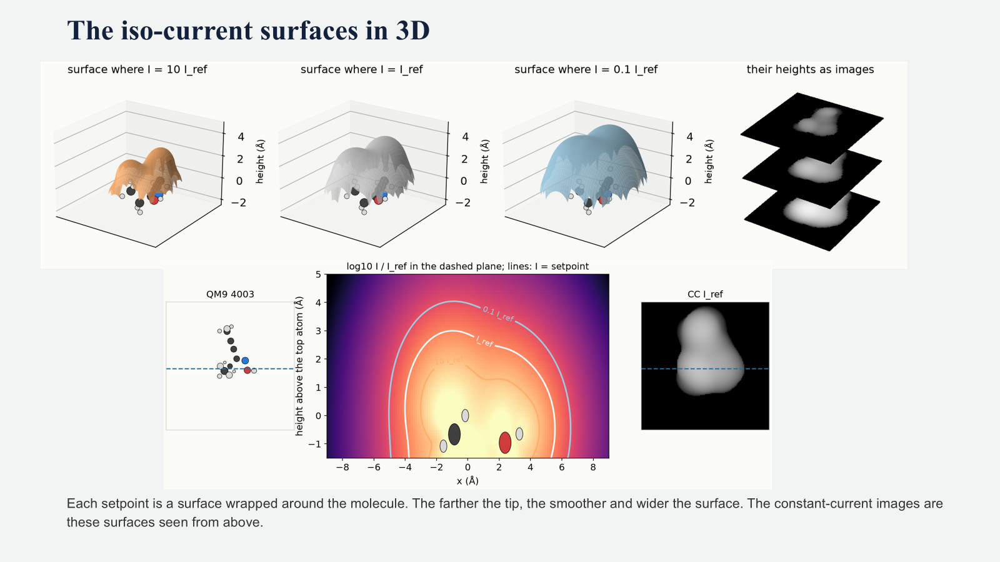
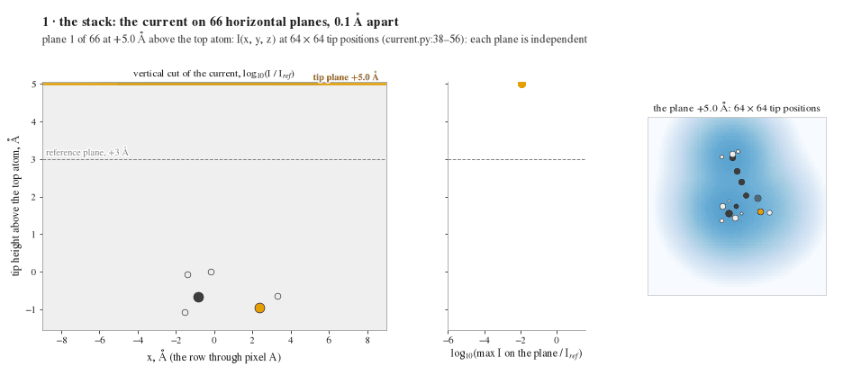

# stmsim: simulated STM images of small molecules

A small numpy package that turns a molecule's electron orbitals into the images a scanning tunnelling microscope
(STM) would record. It was written to produce the QM9 training set of the STM-to-molecule diffusion model, and it
uses the same physics as PP-STM (rigid s-wave tip) with results that match it to the storage precision.

## The idea

An STM tip hovers a few ångström above a molecule, and electrons tunnel across the gap. The current is carried by the
molecule's orbitals and falls by a factor of ten for every ångström of extra distance. In constant-current mode a
feedback loop keeps that current at a chosen setpoint and records how high the tip had to sit at every pixel. The
image is therefore the height of an iso-current surface: a smooth envelope wrapped around the molecule, high over
the atoms that reach furthest up, lower over the rest, and flat where the molecule ends.




## How an image is made

1. **Orbitals.** A DFT calculation (the QH9 settings, read from the QH9 database or run with PySCF) gives the
   orbitals; each is kept as an s part and three p parts per atom.
2. **Current.** At every tip position the current is the weighted sum of the squared orbital amplitudes, each
   decaying exponentially away from the atoms. The weights favour the orbitals nearest the gap.
3. **Reference.** The largest current on the plane 3 Å above the topmost atom defines the reference; the eleven
   setpoints are fixed multiples of it, from 18 times (tip closest) to 0.06 times (farthest).
4. **Constant current.** For every pixel the tip descends plane by plane from 5 Å above the molecule and stops at
   the first plane where the current reaches the setpoint; that height, relative to the 3 Å plane, is the pixel
   value. Where the setpoint is never reached the pixel gets the floor, which becomes the flat background.



## Use

    pip install numpy scipy h5py matplotlib pyscf        # pyscf only for running DFT yourself
    python scripts/simulate_xyz.py examples/molecules/*.xyz --out examples/output
    python scripts/make_qm9_dataset.py --qh9 QH9Stable.db --out data --workers 32
    python -m pytest tests/

```python
from stmsim import from_xyz, heavy_atom_frame, simulate, Settings
mol = from_xyz('examples/molecules/qm9_26844.xyz')
mol.xyz = heavy_atom_frame(mol.xyz, mol.Z)       # lay the molecule flat, z towards the tip
images = simulate(mol, Settings())               # images['topographs']: (11, 64, 64) heights in Å
```

The QM9 script writes one HDF5 file per split with the constant-current images (`qm9_cc`) and, alongside, the
constant-height log-current images (`qm9_log`); `--rotations` places every molecule in the frame of its TERS image,
`--pixels` sets the resolution. The file layout is described at the top of `stmsim/dataset.py`.


## References

- PP-STM: O. Krejčí, P. Hapala, M. Ondráček, P. Jelínek, Phys. Rev. B 95, 045407 (2017).
- QH9: H. Yu et al., NeurIPS 2023 Datasets and Benchmarks.
- ASD-STM: L. Kurki, N. Oinonen, A. S. Foster, ACS Nano 2024.
